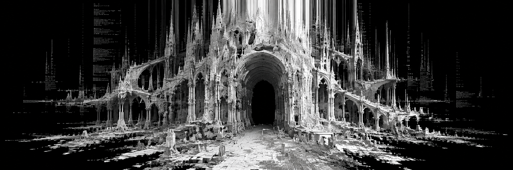
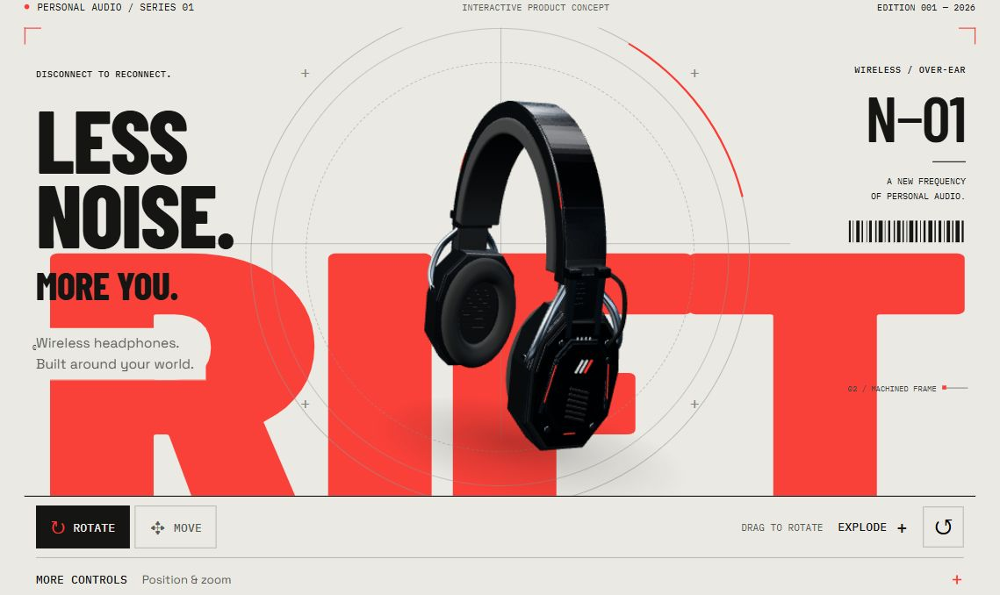
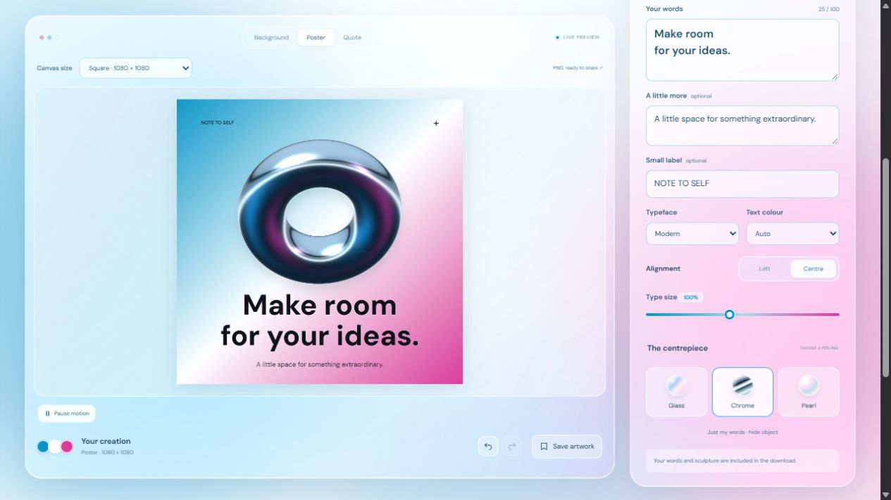

<h1 align="center">Janina</h1>

<b>UI / UX DESIGN &nbsp; · &nbsp; VISUAL DESIGN &nbsp; · &nbsp; INTERACTION</b>

I’m Janina, a UI/UX and visual designer. I turn product ideas into interactive prototypes, combining clear task flows with expressive typography and motion.

<a href="https://dizainostudija.myportfolio.com/"><b>VIEW MY PORTFOLIO ↗</b></a> &nbsp; · &nbsp; <a href="https://dizainostudija.myportfolio.com/contact"><b>GET IN TOUCH ↗</b></a>

OPEN TO UI/UX DESIGN OPPORTUNITIES

---

## Selected interactive work

### 01 / RIFT — Audio in a new form

RIFT is my responsive product website for a fictional headphone brand. I focused on a clear journey from inspecting the 3D model to choosing a finish and saving a setup. Wireframe views and labelled details let visitors explore how the product is put together.

**UI design · 3D interaction · Product exploration**

[**Explore RIFT ↗**](https://jupiter847.github.io/rift-audio/) &nbsp; · &nbsp; [View project](https://github.com/jupiter847/rift-audio)

 

### 02 / Lumi — A little room for your ideas

Lumi is my responsive poster studio for people making quote cards, announcements and social posts. I shaped the flow around **write → style → arrange → export**, with a live preview and direct control of the sculptural object. The glass interface and blue and pink palette give the tool its playful identity.

**Visual design · Interactive prototyping · Creative tools**

[**Try Lumi ↗**](https://jupiter847.github.io/lumi-gradient-studio/) &nbsp; · &nbsp; [View project](https://github.com/jupiter847/lumi-gradient-studio)

---

### What I’m interested in

These projects bring together interface structure, visual hierarchy and direct interaction. My prototypes use HTML, CSS and JavaScript, with Three.js for RIFT’s 3D views.

You can find more of my graphic design, motion and UI/UX work in [my portfolio](https://dizainostudija.myportfolio.com/).
