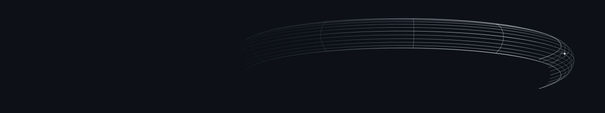
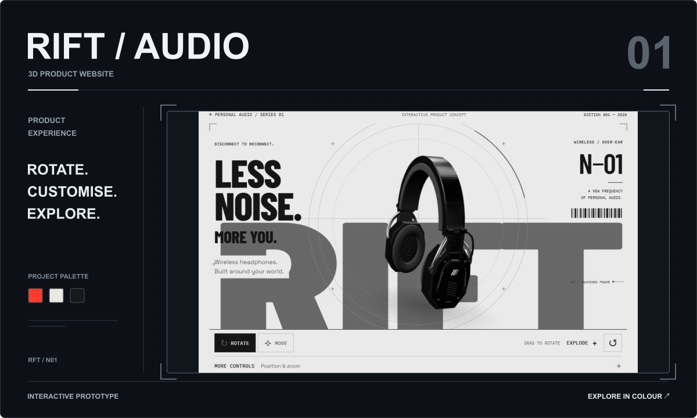
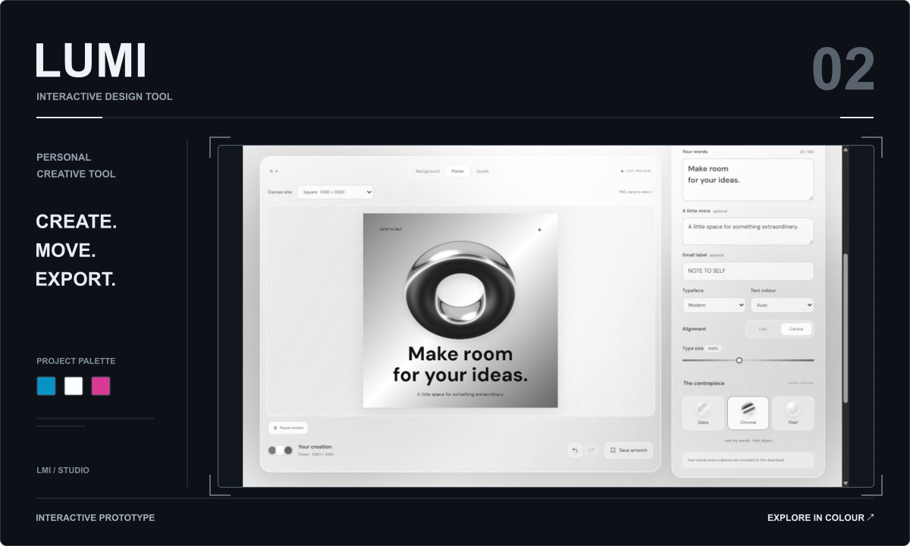

<h1 align="center">Janina</h1>

<b>UI / UX DESIGN &nbsp; · &nbsp; VISUAL DESIGN &nbsp; · &nbsp; INTERACTION</b>

I’m Janina, a UI/UX and visual designer. I turn product ideas into interactive prototypes, combining clear task flows with expressive typography and motion.

<a href="https://dizainostudija.myportfolio.com/"><b>VIEW MY PORTFOLIO ↗</b></a> &nbsp; · &nbsp; <a href="https://dizainostudija.myportfolio.com/contact"><b>GET IN TOUCH ↗</b></a>

OPEN TO UI/UX DESIGN OPPORTUNITIES

---

## Selected interactive work

### 01 / RIFT — Product experience

RIFT is a responsive product website for a fictional headphone brand. The journey moves from inspecting the 3D model to choosing a finish and saving a setup. Wireframe views and labelled details let visitors explore how the product is put together.

**UI design · 3D interaction · Product exploration**

[**Live demo ↗**](https://jupiter847.github.io/rift-audio/) &nbsp; · &nbsp; [View code](https://github.com/jupiter847/rift-audio)

 

### 02 / LUMI — Creative tool

Lumi is a responsive poster studio for quote cards, announcements and social posts. The flow follows **write → style → arrange → export**, with a live preview and direct control of the sculptural object. The glass interface and blue and pink palette give the tool its playful identity.

**Visual design · Interactive prototyping · Creative tools**

[**Live demo ↗**](https://jupiter847.github.io/lumi-gradient-studio/) &nbsp; · &nbsp; [View code](https://github.com/jupiter847/lumi-gradient-studio)

---

### Design focus

These projects bring together interface structure, visual hierarchy and direct interaction. The prototypes use HTML, CSS and JavaScript, with Three.js for RIFT’s 3D views.

You can find more of my graphic design, motion and UI/UX work in [my portfolio](https://dizainostudija.myportfolio.com/).
